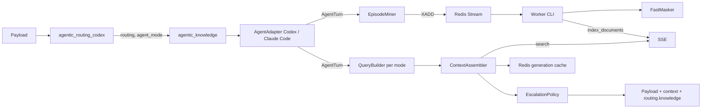

# Agentic knowledge layer (`agentic_knowledge`)

A knowledge layer for coding agents that lives **in the proxy, with no cooperation from the agent**. It reads the
work state the routing plugin has already derived (work mode, phase evidence, request class), retrieves what this
repository has already learned from the **Semantic Search Engine** (SSE), injects it into the request, and learns from
the traffic itself: verified fixes, dead ends, and the window that a compaction is about to throw away. The retrieval
result becomes a routing signal as well — an agent spinning in a loop with no known fix is moved to a stronger model
(*knowledge-or-escalate*).

- **Plugin name (registry key):** `agentic_knowledge`
- **Class:** `llm_router_plugins.utils.knowledge.agentic_knowledge.plugin.AgenticKnowledgePlugin`
- **Default config:** `llm_router_plugins/resources/knowledge/agentic_knowledge.json`
- **Env prefix:** `LLM_ROUTER_KNOWLEDGE_AGENTIC_`
- **Worker:** `llm-router-agentic-kb-worker`
- **Requires:** the SSE client and Redis — both optional, see [Install](#1-install)

It is designed to stand **behind** `agentic_routing_codex` in the utils pipeline: it reads `payload["routing"]`,
`payload["agent_mode"]` and `payload["model"]` as the router left them, and never touches the classifier.

---

## What the plugin changes

| Key                     | Value                                                                   |
|-------------------------|--------------------------------------------------------------------------|
| `input` / `system`      | one extra context block when knowledge was found (adapter-specific)      |
| `model`                 | the escalation model, only when the escalation policy fired              |
| `routing.knowledge`     | annotation of what this plugin did (see [Annotation](#annotation))        |
| `routing.model_before_knowledge` | previous `model`, only when this plugin replaced it           |

Everything else is forwarded unchanged. The plugin never rejects a request.

**Fail-open everywhere except the config file.** A non-dict payload, an unclaimed payload, a parse error, an SSE
timeout, `SSEAPIError`, a missing `sse_lib`, a Redis outage — all return the payload as it came, with at most one
warning that carries no document content. Malformed Redis connection settings disable the features that need Redis and
keep the policy. A malformed **policy** (unknown key, out-of-range weight, non-positive budget) raises at startup, the
same fail-hard rule the Codex router uses.

---

## Quick start

### 1. Install

```bash
pip install -e ".[knowledge]"                       # sse-lib + redis>=5
pip install ../semantic-search-engine/sse_lib       # until sse-lib is published, from the sibling checkout
```

`sse_lib` depends only on `requests`. Without it, and without a configured host, the plugin loads and does nothing.

### 2. Load it into the pipeline, after routing

```bash
export LLM_ROUTER_UTILS_PLUGINS_PIPELINE="agentic_routing_codex,agentic_knowledge"
```

Knowledge needs the routing decision, so it must run after the routing plugin. Registered in
`MAIN_UTILS_REGISTRY` under `agentic_knowledge`; instantiated once per process.

### 3. Point it at SSE and Redis

```bash
export LLM_ROUTER_KNOWLEDGE_AGENTIC_SSE_API_HOST="https://sse.internal"
# A pre-issued token, or a login for an engine that authenticates by username and password
# (the client logs in on its first call; a token, when set, wins).
export LLM_ROUTER_KNOWLEDGE_AGENTIC_SSE_API_TOKEN="…"
export LLM_ROUTER_KNOWLEDGE_AGENTIC_SSE_API_USERNAME="…"
export LLM_ROUTER_KNOWLEDGE_AGENTIC_SSE_API_PASSWORD="…"
export LLM_ROUTER_KNOWLEDGE_AGENTIC_REDIS_HOST="redis.internal"
```

No `SSE_API_HOST` ⇒ **no reads** (requests pass through). No `REDIS_HOST` ⇒ **no writes and no cross-request cache**
(reads stay stateless, see [Stateless mode](#stateless-mode)).

### 4. Run the indexing worker

```bash
export LLM_ROUTER_KNOWLEDGE_AGENTIC_SSE_EMBEDDER="<embedder served by your SSE>"
export LLM_ROUTER_KNOWLEDGE_AGENTIC_SSE_RERANKER="<reranker served by your SSE>"
llm-router-agentic-kb-worker
```

Without a worker the layer only reads: nothing new is ever learned. The embedder and reranker are required because the
worker creates a collection the first time a scope produces knowledge.

### 5. Verify

```bash
python -m pytest tests -q -k agentic_knowledge
bash scripts/agentic-kb-eval.sh --enable-escalation
```

The evaluation script replays recorded sessions offline (no SSE, no Redis) and prints a JSON report; see
[Evaluation](#evaluation).

---

## How it works



One request passes through: **adapter selection → parse → mine once → publish once → read (cache → search → assemble)
→ inject → escalate → annotate**. Mining and publishing happen exactly once per request — the write path never
re-annotates, so an escalation decision cannot be overwritten by it.

| Module             | Responsibility                                                              |
|--------------------|------------------------------------------------------------------------------|
| `plugin.py`        | `AgenticKnowledgePlugin` — the whole request path, fail-open, annotation     |
| `config.py`        | policy JSON + ENV, validation, availability properties                       |
| `adapters/base.py` | `AgentAdapter` (ABC), `AgentTurn`, `KnowledgeEvent`, `InjectionSpec`         |
| `adapters/codex.py`| Codex: reuses `codex.payload`, `codex.phase`; full read **and** write        |
| `adapters/claude_code.py` | Claude Code: scope, latest user text, injection into `system`; read-only |
| `scope.py`         | repository scope from the declared working directory; collection names       |
| `signature.py`     | error/stack trace → stable signature + hash                                  |
| `query.py`         | query and SSE filters per work mode                                          |
| `assembler.py`     | weighted voting over sources, dedup, character budget, rendering             |
| `cache.py`         | `GenerationContextCache` (Redis) + in-memory implementation for tests        |
| `miner.py`         | `EpisodeMiner`: recipe / deadend / loop / compaction → `KnowledgeEvent`      |
| `events.py`        | `KnowledgeEventPublisher`: `SET NX` dedup + `XADD`                           |
| `escalation.py`    | `EscalationPolicy.decide`                                                    |
| `sse.py`           | `KnowledgeStore`: thin fail-open façade over `sse_lib`                       |
| `documents.py`     | document kinds, names, metadata contract                                     |
| `evaluation.py`    | counterfactual replay over recorded sessions                                 |

### Scope

Knowledge is only worth retrieving inside the repository that produced it. The CLI announces no repository, so the
identifier is the one the agent itself prints: `<cwd>` in Codex's `<environment_context>`, the `Working directory` line
in Claude Code's `system`. That path becomes a path-free **scope key** (`scope.strategy`):

- `repo_basename` (default) — the name of the checked-out directory;
- `parent_directory` — `<parent>/<repo>`, for monorepos under a common parent;
- `scope.overrides` — an explicit `declared path → scope key` table, for checkouts that share a basename.

One collection per scope keeps isolation out of the query: a search of one repository cannot return a document of
another, even if a metadata filter is forgotten. The absolute path itself is never indexed. With no declared directory
the scope is unknown, and both reads and writes are skipped (`scope: ""` in the annotation).

### Collections and documents

| Kind              | Collection                       | Produced by                    |
|-------------------|----------------------------------|--------------------------------|
| `recipe`          | `<prefix>_<scope>`               | `test_failure → patch → test pass` |
| `deadend`         | `<prefix>_<scope>`               | a repeated failure, a dead end |
| `doc`             | `<prefix>_<scope>`               | nothing yet (reserved for conventions indexed by you) |
| `session_archive` | `<prefix>_<scope>_sessions`      | a request classified `compaction` |

Default `<prefix>` is `agentic_kb`. A collection is `<prefix>_<scope>` (and
`<prefix>_<scope>_sessions` for the archive); the engine's character set —
letters, digits, `_`, `.` — is enforced at configuration time, **on both the
prefix and the scope**, because the scope is a checkout's directory name and
the engine refuses a hyphen (a 500) in a collection name: `llm-router` becomes
`<prefix>_llm_router`. A document is named `<kind>:<YYYYMMDD>:<fingerprint>` —
the day bucket is what retention ages on. Every entry is one document with its
metadata in `metadata_json`, filtered by `eq`/`in`.

### Read path: retrieval per work mode

`QueryBuilder` builds a query from what the mode is actually doing:

| Mode              | Query                                                                        |
|-------------------|------------------------------------------------------------------------------|
| `debug`           | signature of the last `test_failure` + the latest user text                   |
| `test`            | the test command + touched paths                                              |
| `implement`       | latest user text + touched paths                                              |
| `plan`            | latest user text                                                              |
| `git_review`, `review` | paths from patches                                                       |

Each mode has a policy — the sources it reads, their weights, `max_items`, and a character budget:

```jsonc
"debug": {
  "max_chars": 6000,
  "sources": [
    {"category": "recipe",          "weight": 1.0, "max_items": 3},
    {"category": "deadend",         "weight": 0.9, "max_items": 3},
    {"category": "session_archive", "weight": 0.6, "max_items": 3}
  ],
  "escalation_model_name": "qwen/Qwen3.8-27B"
}
```

A source may also restrict the **phases** it is read in — the work the episode was
doing (`test`, `implement`, …), which is *not* the document kind: a `recipe` mined
while `implement`ing is still a recipe — or its **modes**, the routing mode the
router resolved for the request that produced it.  An empty list — the default —
reads the source in every phase or mode.  The restriction becomes engine-side
`metadata_filters` on `phase` (or `mode`), one filter per name, which the engine
unions; it intersects with the source's categories.  Phases and modes share the
single metadata slot the engine allows, so a policy may restrict one dimension
but not both in one request (configuration error), an archived source never
carries either — its `thread_id` filter owns the slot — and one source without a
restriction leaves the whole request unrestricted (sources of one collection are
retrieved by one search).

```jsonc
{"category": "recipe", "weight": 1.0, "max_items": 3, "phases": ["test", "debug"]}
{"category": "deadend", "weight": 0.9, "modes": ["debug"]}
```

`ContextAssembler` normalizes SSE's `score_normalized`, multiplies by the source weight, adds a bonus when a document's
error signature or paths match the current turn, deduplicates by document name, and cuts to the budget. Sections are
rendered in a fixed order inside constant markers:

```
<agentic_knowledge>
## Verified fixes in this repo
## Known dead ends (do not repeat)
## Exact context from before compaction
## Conventions
</agentic_knowledge>
```

Every entry is cited with the phase it was learned in — `[recipe · in test · 2026-10-12 · src/a.py]` — so
the agent can tell a fix it verified in a test run from one it learned by editing.

The block is injected as **the last element of `input`** (Codex: a `developer` message) — not into `instructions`, so
the prompt cache prefix of the CLI survives and the block stays removable. The client does not echo our element back,
so the same block is re-injected for the whole command generation from the cache. If `<agentic_knowledge>` is already
in the payload the injection is skipped, which keeps a second pass through the pipeline idempotent. Empty result ⇒ no
element at all.

### Generation cache

`GenerationContextCache` stores the injected set under `<key_prefix>:ctx:<scope>:<generation>` (`generation` =
`thread_id` + `root_turn_id`, the same identity the Codex memory uses) with `cache_ttl_seconds` (default 3600). A hit
returns byte-identical text and issues **zero** SSE calls. The entry is refreshed when the mode changes or the phase
evidence fingerprint moved. The escalated model is stored with the entry, so a loop escalated earlier in a generation
stays escalated even when a later request no longer repeats the loop by itself.

### Write path

`EpisodeMiner` reads the turn's phase evidence — `collect_phase_evidence` from the Codex package, no second parser —
and emits `recipe` for a `test_failure → patch → test pass` episode and `deadend` for a failure that repeats with an
identical signature.  Each event carries the **phase** its own evidence names — the mode most of its items are in,
the newest one breaking a tie, the turn's mode when it names none — which the worker writes into the document
header and into `metadata_json.phase`, verbatim (it is a filter key, like `thread_id`). Codex resends the whole history with every request, so episodes are recomputed each time and
deduplicated before publishing: `SET NX <fingerprint> EX <dedup_ttl_seconds>` in front of `XADD`, and `XADD … MAXLEN ~
<max_stream_len>`. If `XADD` fails the dedup key is released, so the episode is retried rather than silently lost.

The worker (`llm-router-agentic-kb-worker`) consumes the stream with a consumer group, masks every document with
`FastMasker` and **discards the mappings** (no re-identification is possible downstream) — the filter keys
(`thread_id`, `scope`, `kind`, `mode`, `phase`, …) are written verbatim so a document can be read back — creates the
collection on first use, then `index_documents(category=<kind>, options=<metadata>)`. Logs never contain document text. Retention
deletes only this plugin's own documents older than the configured TTL (`session_archive` on `archive.ttl_seconds`).
Events with an unknown version are acknowledged and logged; an indexing error is retried up to a bounded number of
attempts and then dropped with a log, so one poison event cannot stall the stream.

### Compaction archive

A request classified `compaction` is **written, never read from**: the full window is chunked at message/tool-result
boundaries (`archive.max_chunk_chars`) and indexed into `<prefix>-<scope>-sessions` with `thread_id`, `window_id` and
`position`. The next `main` request of the same thread reads that collection filtered by `thread_id`, so the exact
lines a summary dropped come back as `## Exact context from before compaction`.

### Knowledge-or-escalate

`EscalationPolicy.decide(turn, context, policy, loop_count, signature_hash)` escalates only when **all** of these hold:

1. `routing_source != "explicit"` — the operator who named a model is never overridden;
2. the mode has an `escalation_model_name`;
3. `loop_count >= loop_threshold` (default `3`) — the same error signature failed that many times in the generation;
4. `best_recipe_score < strong_recipe_score` (default `0.75`) — the knowledge base has no known fix.

Outcomes are `none`, `keep` (a strong recipe exists, the routed model stays) and `escalate`, with reasons `disabled`,
`explicit_mode`, `no_loop`, `no_escalation_model`, `strong_recipe`, `loop_without_recipe`. On `escalate` the adapter
sets the model and `routing.model_before_knowledge` records the previous one. The policy is **off in the shipped
config** (`escalation.enabled=false`) — enable it only after the replay shows the loop detection is right, because a
flaky test looks exactly like a loop. The "already tried" list comes from the current turn's dead ends plus retrieved
`deadend` hits and lands in `## Known dead ends (do not repeat)`.

### Annotation

`payload["routing"]["knowledge"]` — safe for logs: no document text, no tokens, no hosts, no full session ids.

```jsonc
{
  "plugin": "agentic_knowledge",
  "adapter": "codex",
  "scope": "webapp",
  "injected": 3,
  "chars": 1180,
  "sources": {"recipe": 2, "deadend": 1},
  "cache": "hit",                  // hit | miss | disabled | unavailable
  "loop_count": 3,
  "escalation": {"action": "escalate", "reason": "loop_without_recipe",
                  "from": "auto_codex", "to": "qwen/Qwen3.8-27B"},
  "write": {"published": 1, "deduplicated": 0, "status": "ok"}   // ok | unavailable
}
```

---

## Configuration

Policy is JSON (reviewable, versionable, no secrets); every connection is ENV only. Precedence: **ENV → JSON →
built-in defaults**. A value present but malformed is an error, except connection settings, where a missing host just
means the feature is unavailable.

```jsonc
{
  "adapters": ["codex", "claude_code"],
  "collection_prefix": "agentic_kb",
  "scope": {"strategy": "repo_basename", "overrides": {}, "default": ""},
  "read": {"enabled": true, "timeout_seconds": 1.5, "min_similarity": 0.35,
            "cache_ttl_seconds": 3600, "max_lookups_per_generation": 20},
  "modes": { "debug": {…}, "test": {…}, "implement": {…},
              "plan": {…}, "git_review": {…}, "review": {…} },
  "claude_code": {"mode_map": {}},
  "write": {"enabled": true, "stream_key": "agentic_kb:events",
             "max_stream_len": 100000, "dedup_ttl_seconds": 604800,
             "max_patch_chars": 4000,
             "archive": {"enabled": true, "max_chunk_chars": 2000,
                          "ttl_seconds": 1209600}},
  "escalation": {"enabled": false, "loop_threshold": 3, "strong_recipe_score": 0.75}
}
```

### Environment variables

All use the prefix `LLM_ROUTER_KNOWLEDGE_AGENTIC_`. Booleans accept `1/0`, `true/false`, `yes/no`, `on/off`.

| Variable                             | Default          | Purpose                                                |
|--------------------------------------|------------------|---------------------------------------------------------|
| `…_ENABLED`                           | `true`           | master switch for the whole plugin                       |
| `…_CONFIG`                            | bundled JSON     | raw JSON string **or** path to a policy file             |
| `…_READ_ENABLED`                      | `true`           | injection on/off (writes may stay on)                    |
| `…_WRITE_ENABLED`                     | `true`           | publishing on/off (reads may stay on)                    |
| `…_ARCHIVE_ENABLED`                   | `true`           | compaction archiving on/off                              |
| `…_ESCALATION_ENABLED`                | **`false`**      | model escalation on/off                                  |
| `…_COLLECTION_PREFIX`                 | `agentic_kb`     | prefix of every SSE collection (letters/digits/`_`/`.` only) |
| `…_KEY_PREFIX`                        | `agentic-kb`     | Redis key namespace                                      |
| `…_SSE_API_HOST`                      | **empty**        | **empty ⇒ no reads**                                     |
| `…_SSE_API_PREFIX`                    | **empty**        | empty ⇒ `sse_lib.endpoints.DEFAULT_API_PREFIX` (`api`); set it only when the engine is mounted elsewhere |
| `…_SSE_API_TOKEN`                     | empty            | SSE token (never logged); when set, it wins over a login |
| `…_SSE_API_USERNAME` / `…_SSE_API_PASSWORD` | empty      | engine login for an engine that authenticates by login rather than by a token; the client logs in on its first call; neither is ever logged |
| `…_SSE_API_TIMEOUT`                   | `1.5`            | per-request ceiling, clamped to `0.1…10` s               |
| `…_SSE_VERIFY`                        | `true`           | TLS certificate verification                             |
| `…_READ_TIMEOUT_SECONDS`              | `1.5`            | read-path timeout budget                                 |
| `…_MIN_SIMILARITY`                    | `0.35`           | floor for a hit                                          |
| `…_CACHE_TTL_SECONDS`                 | `3600`           | lifetime of one generation's context                     |
| `…_MAX_LOOKUPS_PER_GENERATION`        | `20`             | in-process limiter used in stateless mode                |
| `…_MAX_STREAM_LEN`                    | `100000`         | `XADD MAXLEN ~`                                          |
| `…_DEDUP_TTL_SECONDS`                 | `604800`         | episode dedup window                                     |
| `…_MAX_PATCH_CHARS`                   | `4000`           | patch text admitted into an event                        |
| `…_ARCHIVE_MAX_CHUNK_CHARS`           | `2000`           | archive chunk size                                       |
| `…_ARCHIVE_TTL_SECONDS`               | `1209600`        | archive retention                                        |
| `…_LOOP_THRESHOLD`                    | `3`              | repetitions of one signature that make a loop            |
| `…_STRONG_RECIPE_SCORE`               | `0.75`           | a recipe this good keeps the routed model                |
| `…_REDIS_HOST`                        | **empty**        | **empty ⇒ no writes, no cache**                          |
| `…_REDIS_PORT` / `…_REDIS_DB` / `…_REDIS_PROTOCOL` | `6379` / `0` / `3` | Redis connection                           |
| `…_REDIS_USERNAME` / `…_REDIS_PASSWORD`  | empty         | optional ACL / AUTH                                      |
| `…_REDIS_SSL`, `…_REDIS_SSL_*`          | off            | TLS and its material (same contract as Codex memory)     |
| `…_REDIS_SOCKET_CONNECT_TIMEOUT` / `…_REDIS_SOCKET_TIMEOUT` | `1.0` | short positive timeouts             |

Redis settings come from these fixed variables only — never from JSON, a Redis URL, `REDIS_*`, `LLM_ROUTER_REDIS_*` or
`AUTH_REDIS_*`. They are read through `connection_from_env(prefix)` reused from `codex/state.py`.

### Worker environment

| Variable                                   | Default        | Purpose                                       |
|--------------------------------------------|----------------|------------------------------------------------|
| `…_WORKER_GROUP`                            | `agentic-kb`   | consumer group name                             |
| `…_WORKER_CONSUMER`                         | `worker-<ts>-<pid>` | this consumer's name in the group          |
| `…_WORKER_BATCH`                            | `32`           | events claimed per read                         |
| `…_WORKER_BLOCK_MS`                         | `5000`         | how long a read waits for work                  |
| `…_MAX_PENDING`                             | `1000`         | pending length above which the worker warns     |
| `…_SSE_EMBEDDER`                            | empty          | **required** to create a collection             |
| `…_SSE_RERANKER`                            | empty          | **required** to create a collection             |
| `…_SSE_INDEX_TYPE`                          | `HNSW`         | `HNSW` or `IVF_FLAT`                            |
| `…_SSE_CHUNK_TOKENS` / `…_SSE_CHUNK_OVERLAP` | `0`            | `0` leaves the server default                   |
| `…_RETENTION_INTERVAL_SECONDS`              | `21600`        | seconds between retention passes; `0` disables  |

CLI: `--config <path>`, `--once` (drain one batch and exit — cron friendly), `--no-retain`, `--log-level`.

---

## Adapters

### Codex (full)

Claims requests with the Codex Responses shape, reuses `CodexPayloadParser`, `collect_phase_evidence` and
`CodexPhaseConfig` rather than parsing again. Full read **and** write: request class, activity, phase evidence, touched
paths and the compaction window all come from it. Contract tests for `CodexRequest`/`PhaseEvidence` live in
`tests/test_agentic_knowledge_codex_adapter.py` — a change there must keep those contracts.

Tool output is recognized by the Codex envelope (`Process exited with code N`); without it the phase pipeline cannot
see a test failure, so no `test_failure` evidence, no recipe, no loop.

### Claude Code (basic)

Claims requests whose `routing.plugin` is `agentic_routing_claude_code`, or that carry the Anthropic `messages` +
`system` shape. Scope comes from the `Working directory` line in `system`, `latest_user_text` from the last `user`
message, session identity from `metadata.user_id` when present. The work mode is the tier from `routing.mode` mapped
through `claude_code.mode_map` — empty by default, which means every request is served as `implement`. The block is
appended to `system` (string or list of blocks; `cache_control` is left alone). `set_model` writes `payload["model"]`.

**No miner and no escalation**: the Anthropic payload carries no phase evidence, so nothing can be verified and a loop
cannot be seen. Claude Code requests read the shared knowledge base; they do not add to it.

---

## Privacy, masking, retention

- The worker masks every document with `FastMasker` and drops the mappings, so an indexed document cannot be reversed.
- Paths outside `repo_root` are dropped from metadata; only paths relative to the repository are stored. Absolute paths
  and the declared working directory are never indexed.
- Annotation and logs carry no document content, no tokens, no hosts, no full session ids.
- Retention deletes only documents of this plugin's own collections. `session_archive` ages on `archive.ttl_seconds`
  (default 14 days), which is the shortest-lived and largest-volume kind.
- Masking is **rule-based, not semantic**. Fixtures with production data are not safe here: do not enable the layer on
  repositories whose test data carries real customer content.

## Stateless mode

With no Redis the plugin still reads: no cache, no writes, and `max_lookups_per_generation` as an **in-process**
limiter. That limit is per worker process, so the number of SSE calls grows with the number of workers — there is no
shared guarantee, and the escalated model does not survive to the next request of the generation. There is deliberately
no local file fallback, because a fallback that diverges between workers is worse than no fallback at all.

## Evaluation

```bash
bash scripts/agentic-kb-eval.sh                 # no KB, read
bash scripts/agentic-kb-eval.sh --enable-escalation
```

`evaluation.py` replays recorded sequences (`tests/data/agentic_knowledge_eval.json`, anonymized prefixes from
`agents-conversation/`) offline. For request *k* the fake store is fed **only** events mined before *k*, so no future
knowledge leaks backwards, and the question is whether retrieval would have returned the fix the session eventually
used. Metrics: `recipe_hit_rate`, `turns_potentially_saved`, `missed_saves`, `loop_detection_precision/recall`,
`escalations`, `injected_chars_per_turn`, reported per variant: `no_kb`, `read`, `read_escalate`. Use it to decide
whether escalation is worth enabling; `tests/test_agentic_knowledge_evaluation.py` keeps the replay deterministic and
leak-free.

## Limitations

- **Signature quality decides everything.** Loop detection and recipe relevance both hang on `signature.py`, which
  normalizes paths, line numbers, addresses, hashes and timestamps. Verify on real output before trusting a threshold.
- **Token cost.** Re-injecting every request of a generation costs tokens, bounded per mode by `max_chars`; the
  `chars` field of the annotation is the meter.
- **Document count.** Every knowledge entry is a separate SSE document, so collections grow; hence retention and
  `max_stream_len`.
- **False escalations.** A flaky test looks like a loop. Identical signatures and `loop_threshold` help; keep
  `ESCALATION_ENABLED` off until the replay is convincing.
- **No architectural decisions.** The `decision` document type is reserved, not mined — extraction needs generation.
- **Coupling to the `codex` package.** The adapter imports its parser, phase and state modules explicitly; their
  contracts are pinned by tests.

## See also

- `llm_router_plugins/utils/routing/agentic_routing/codex/README.md` — the routing plugin this layer builds on.
- `../../../../agentic-knowledge-layer-re.md` in the repository root — the plan this implementation follows.
- `scripts/agentic-kb-eval.sh` — the offline replay.
