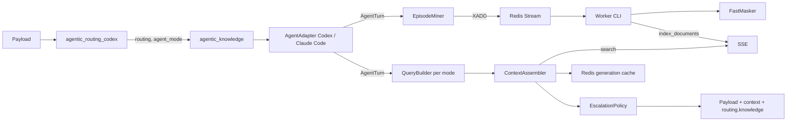

# Agentic knowledge layer (`agentic_knowledge`)

A knowledge layer for coding agents that lives **in the proxy, with no cooperation from the agent**. It reads the
work state the routing plugin has already derived (work mode, phase evidence, request class), retrieves what this
repository has already learned from the **Semantic Search Engine** (SSE), injects it into the request, and learns from
the traffic itself: verified fixes, dead ends, and the window that a compaction is about to throw away. The retrieval
result becomes a routing signal as well — an agent spinning in a loop with no known fix is moved to a stronger model
(*knowledge-or-escalate*).

- **Plugin name (registry key):** `agentic_knowledge`
- **Class:** `llm_router_plugins.utils.knowledge.agentic_knowledge.plugin.AgenticKnowledgePlugin`
- **Default config:** `llm_router_plugins/resources/knowledge/agentic_knowledge.json`
- **Env prefix:** `LLM_ROUTER_KNOWLEDGE_AGENTIC_`
- **Worker:** `llm-router-agentic-kb-worker`
- **Requires:** the SSE client and Redis — both optional, see [Install](#1-install)

It is designed to stand **behind** `agentic_routing_codex` in the utils pipeline: it reads `payload["routing"]`,
`payload["agent_mode"]` and `payload["model"]` as the router left them, and never touches the classifier.

---

## What the plugin changes

| Key                     | Value                                                                   |
|-------------------------|--------------------------------------------------------------------------|
| `input` / `system`      | one extra context block when knowledge was found (adapter-specific)      |
| `model`                 | the escalation model, only when the escalation policy fired              |
| `routing.knowledge`     | annotation of what this plugin did (see [Annotation](#annotation))        |
| `routing.model_before_knowledge` | previous `model`, only when this plugin replaced it           |

Everything else is forwarded unchanged. The plugin never rejects a request.

**Fail-open everywhere except the config file.** A non-dict payload, an unclaimed payload, a parse error, an SSE
timeout, `SSEAPIError`, a missing `sse_lib`, a Redis outage — all return the payload as it came, with at most one
warning that carries no document content. Malformed Redis connection settings disable the features that need Redis and
keep the policy. A malformed **policy** (unknown key, out-of-range weight, non-positive budget) raises at startup, the
same fail-hard rule the Codex router uses.

---

## Quick start

### 1. Install

```bash
pip install -e ".[knowledge]"                       # sse-lib>=0.1.0 + redis>=5
```

`sse_lib` depends only on `requests`. Without it, and without a configured host, the plugin loads and does nothing.

### 2. Load it into the pipeline, after routing

```bash
export LLM_ROUTER_UTILS_PLUGINS_PIPELINE="agentic_routing_codex,agentic_knowledge"
```

Knowledge needs the routing decision, so it must run after the routing plugin. Registered in
`MAIN_UTILS_REGISTRY` under `agentic_knowledge`; instantiated once per process.

### 3. Point it at SSE and Redis

```bash
export LLM_ROUTER_KNOWLEDGE_AGENTIC_SSE_API_HOST="https://sse.internal"
# A pre-issued token, or a login for an engine that authenticates by username and password
# (the client logs in on its first call; a token, when set, wins).
export LLM_ROUTER_KNOWLEDGE_AGENTIC_SSE_API_TOKEN="…"
export LLM_ROUTER_KNOWLEDGE_AGENTIC_SSE_API_USERNAME="…"
export LLM_ROUTER_KNOWLEDGE_AGENTIC_SSE_API_PASSWORD="…"
export LLM_ROUTER_KNOWLEDGE_AGENTIC_REDIS_HOST="redis.internal"
```

No `SSE_API_HOST` ⇒ **no reads** (requests pass through). No `REDIS_HOST` ⇒ **no writes**, and the generation cache
falls back to one that lives in the process only (reads stay stateless across workers, see [Stateless mode](#stateless-mode)).

### 4. Run the indexing worker

```bash
export LLM_ROUTER_KNOWLEDGE_AGENTIC_SSE_EMBEDDER="<embedder served by your SSE>"
export LLM_ROUTER_KNOWLEDGE_AGENTIC_SSE_RERANKER="<reranker served by your SSE>"
llm-router-agentic-kb-worker
```

Without a worker the layer only reads: nothing new is ever learned. The embedder and reranker are required because the
worker creates a collection the first time a scope produces knowledge.

The worker is a second process, started by the operator — the router never spawns it. The `llm-router` checkout
wraps that for a deployment whose configuration lives in the router's own run script: `run-agentic-kb-worker.sh`
reads that script's assignments (never executes it, so no second server starts), exports them, and runs the
worker with the rest of its arguments.

```bash
# from the llm-router checkout (sibling of this one)
bash run-agentic-kb-worker.sh [ROUTER_SCRIPT] [--once | --no-retain | --log-level …]
bash run-agentic-kb-worker-pk.sh    # the personal run-rest-api-gunicorn-pk.sh environment
```

Run it with `--once` from cron to drain a backlog, or without it as a daemon. `--once` logs what the batch did,
because otherwise a cron run that indexed nothing and a cron run that did nothing are indistinguishable.

### 5. Verify

```bash
python -m pytest tests -q -k agentic_knowledge
bash scripts/agentic-kb-eval.sh --enable-escalation
```

The evaluation script replays recorded sessions offline (no SSE, no Redis) and prints a JSON report; see
[Evaluation](#evaluation).

---

## How it works



One request passes through: **adapter selection → parse → mine once → publish once → read (cache → search → assemble)
→ inject → escalate → annotate**. Mining and publishing happen exactly once per request — the write path never
re-annotates, so an escalation decision cannot be overwritten by it.

A request the router classified `aux_title` is returned before any of this — a title generation has no repository
knowledge to use, and none is mined from it, so it carries no annotation.

| Module             | Responsibility                                                              |
|--------------------|------------------------------------------------------------------------------|
| `plugin.py`        | `AgenticKnowledgePlugin` — the whole request path, fail-open, annotation     |
| `config.py`        | policy JSON + ENV, validation, availability properties                       |
| `adapters/base.py` | `AgentAdapter` (ABC), `AgentTurn`, `KnowledgeEvent`, `InjectionSpec`         |
| `adapters/codex.py`| Codex: reuses `codex.payload`, `codex.phase`; full read **and** write        |
| `adapters/claude_code.py` | Claude Code: scope, latest user text, injection into `system`; read-only |
| `scope.py`         | repository scope from the declared working directory; collection names       |
| `signature.py`     | error/stack trace → stable signature + hash                                  |
| `query.py`         | query and SSE filters per work mode                                          |
| `assembler.py`     | weighted voting over sources, dedup, character budget, rendering             |
| `cache.py`         | `GenerationContextCache` (Redis) + in-process one when Redis is absent       |
| `redisclient.py`   | `RedisClientHandle`: lazy, fork-aware Redis client shared by cache and pub   |
| `miner.py`         | `EpisodeMiner`: recipe / deadend / loop / compaction → `KnowledgeEvent`      |
| `docs_ingestor.py` | scans the repository's markdown into `doc` documents and keeps them current  |
| `doc_context.py`   | the standing map of that documentation a session carries, and where it lives |
| `events.py`        | `KnowledgeEventPublisher`: `SET NX` dedup + `XADD`                           |
| `escalation.py`    | `EscalationPolicy.decide`                                                    |
| `sse.py`           | `KnowledgeStore`: thin fail-open façade over `sse_lib`                       |
| `documents.py`     | document kinds, names, metadata contract                                     |
| `evaluation.py`    | counterfactual replay over recorded sessions                                 |

### Scope

Knowledge is only worth retrieving inside the repository that produced it. The CLI announces no repository, so the
identifier is the one the agent itself prints: `<cwd>` in Codex's `<environment_context>`, the `Working directory` line
in Claude Code's `system`. A compaction re-sends the whole conversation, and that block then sits behind the
developer instructions — so the leading messages are searched (a fraction of a millisecond, bounded) rather than the
first item assumed. A directory quoted in a tool output is not a declaration: only what the agent sends as a message
names a repository. That path becomes a path-free **scope key** (`scope.strategy`):

- `repo_basename` (default) — the name of the checked-out directory;
- `parent_directory` — `<parent>/<repo>`, for monorepos under a common parent;
- `scope.overrides` — an explicit `declared path → scope key` table, for checkouts that share a basename.

One collection per scope keeps isolation out of the query: a search of one repository cannot return a document of
another, even if a metadata filter is forgotten. The absolute path itself is never indexed. With no declared directory
the scope is unknown, and both reads and writes are skipped (`scope: ""` in the annotation).

### Collections and documents

| Kind              | Collection                       | Produced by                                          |
|-------------------|----------------------------------|--------------------------------------------------------|
| `recipe`          | `<prefix>_<scope>`               | `test_failure → patch → test pass`                      |
| `deadend`         | `<prefix>_<scope>`               | a repeated failure, a dead end                          |
| `doc`             | `<prefix>_<scope>_docs`          | the repository's markdown — [Documentation](#documentation-doc) |
| `session_archive` | `<prefix>_<scope>_sessions`      | a request classified `compaction`                       |

Default `<prefix>` is `agentic_kb`. A collection is `<prefix>_<scope>` (and
`<prefix>_<scope>_sessions` for the archive, `<prefix>_<scope>_docs` for the
repository's own documentation); the engine's character set —
letters, digits, `_`, `.` — is enforced at configuration time, **on both the
prefix and the scope**, because the scope is a checkout's directory name and
the engine refuses a hyphen (a 500) in a collection name: `llm-router` becomes
`<prefix>_llm_router`. A document is named `<kind>:<YYYYMMDD>:<fingerprint>` —
the day bucket is what retention ages on. Every entry is one document with its
metadata in `metadata_json`, filtered by `eq`/`in`.

### Read path: retrieval per work mode

`QueryBuilder` builds a query from what the mode is actually doing:

| Mode              | Query                                                                        |
|-------------------|------------------------------------------------------------------------------|
| `debug`           | signature of the last `test_failure` + the latest user text                   |
| `test`            | the test command + touched paths                                              |
| `implement`       | latest user text + touched paths                                              |
| `plan`            | latest user text                                                              |
| `git_review`, `review` | paths from patches                                                       |

Each mode has a policy — the sources it reads, their weights, `max_items`, and a character budget:

```jsonc
"debug": {
  "max_chars": 6000,
  "sources": [
    {"category": "recipe",          "weight": 1.0, "max_items": 3},
    {"category": "deadend",         "weight": 0.9, "max_items": 3},
    {"category": "session_archive", "weight": 0.6, "max_items": 3}
  ],
  "escalation_model_name": "qwen/Qwen3.8-27B"
}
```

A source may also restrict the **phases** it is read in — the work the episode was
doing (`test`, `implement`, …), which is *not* the document kind: a `recipe` mined
while `implement`ing is still a recipe — or its **modes**, the routing mode the
router resolved for the request that produced it.  An empty list — the default —
reads the source in every phase or mode.  The restriction becomes engine-side
`metadata_filters` on `phase` (or `mode`), one filter per name, which the engine
unions; it intersects with the source's categories.  Phases and modes share the
single metadata slot the engine allows, so a policy may restrict one dimension
but not both in one request (configuration error), an archived source never
carries either — its `thread_id` filter owns the slot — and one source without a
restriction leaves the whole request unrestricted (sources of one collection are
retrieved by one search).

The `doc` source carries a third dimension of the same kind: **`doc_types`**,
the documentation kinds it reads — `readme`, `guide`, `changelog`,
`contributing`, `security`, `license`, `agent`, `note`.  One `eq` filter per
kind, the engine unions them.  It is the `doc` source's own restriction, in its
own collection and its own request, so it never collides with the phase and
mode dimensions above; a `doc` source that also lists phases or modes is a
configuration error, as is a `doc_types` list on any other source (a mined
episode carries no `doc_type`, and the filter would read as empty).  The
shipped policy is deliberate per work mode: `implement` reads `readme`, `guide`
and `contributing`, `plan` adds `changelog` and `note`, and `review` reads
`guide`, `contributing` and `security`.  `agent` (an `AGENTS.md`) is in no
list: the agent already receives that file in its own context, and retrieving
it again would only spend the mode's budget on words it has been given.

```jsonc
{"category": "recipe", "weight": 1.0, "max_items": 3, "phases": ["test", "debug"]}
{"category": "deadend", "weight": 0.9, "modes": ["debug"]}
{"category": "doc", "weight": 0.8, "max_items": 3, "doc_types": ["guide", "contributing", "security"]}
```

`ContextAssembler` normalizes SSE's `score_normalized`, multiplies by the source weight, adds a bonus when a document's
error signature or paths match the current turn, and a further documentation bonus when a retrieved guide
**documents a file the turn is touching** — `docs/export.md` for an edited `src/export.py` — a link no retrieval leg
can see, deduplicates by document name, and cuts to the budget. A `doc` hit whose declared kind the mode does not read
is dropped on the client, as the second voice of the engine's own `doc_type` filter. Sections are
rendered in a fixed order inside constant markers:

```
<agentic_knowledge>
## Verified fixes in this repo
## Known dead ends (do not repeat)
## Exact context from before compaction
## Conventions
</agentic_knowledge>
```

Every entry is cited with the phase it was learned in — `[recipe · in test · 2026-10-12 · src/a.py]` — so
the agent can tell a fix it verified in a test run from one it learned by editing.

A repository whose first episode has not been indexed yet has no collection at all, and the engine says so with an error code rather than an empty list; the read path answers it as an empty one (nothing known yet, no warning per request) until the worker creates the collection on that first event.

The block is injected as **the last element of `input`** (Codex: a `developer` message) — not into `instructions`, so
the prompt cache prefix of the CLI survives and the block stays removable. The client does not echo our element back,
so the same block is re-injected for the whole command generation from the cache. If `<agentic_knowledge>` is already
in the payload the injection is skipped, which keeps a second pass through the pipeline idempotent. Empty result ⇒ no
element at all.

### Generation cache

`GenerationContextCache` stores the injected set under `<key_prefix>:ctx:<scope>:<generation>` (`generation` =
the Codex `turn_id`, the same identity the Codex memory treats as one command generation; when the CLI sends none,
the adapter falls back to a hash of `thread_id` + input items, then to `root_turn_id`) with `cache_ttl_seconds`
(default 3600). A hit
returns byte-identical text and issues **zero** SSE calls. The entry is refreshed when the mode changes or the phase
evidence fingerprint moved. The escalated model is stored with the entry, so a loop escalated earlier in a generation
stays escalated even when a later request no longer repeats the loop by itself.

### Write path

`EpisodeMiner` reads the turn's phase evidence — `collect_phase_evidence` from the Codex package, no second parser —
and emits `recipe` for a `test_failure → patch → test pass` episode and `deadend` for a failure that repeats with an
identical signature.  Each event carries the **phase** its own evidence names — the mode most of its items are in,
the newest one breaking a tie, the turn's mode when it names none — which the worker writes into the document
header and into `metadata_json.phase`, verbatim (it is a filter key, like `thread_id`). Codex resends the whole history with every request, so episodes are recomputed each time and
deduplicated before publishing: `SET NX <fingerprint> EX <dedup_ttl_seconds>` in front of `XADD`, and `XADD … MAXLEN ~
<max_stream_len>`. If `XADD` fails the dedup key is released, so the episode is retried rather than silently lost.
A request whose repository is unknown publishes nothing: its documents would have no repository's collection to live
in — the reader asks for a scope's collection, never the bare prefix — and every scope-less checkout would archive
into that one prefix, which is the isolation the scope exists to prevent.

The worker (`llm-router-agentic-kb-worker`) consumes the stream with a consumer group, masks every document with
`FastMasker` and **discards the mappings** (no re-identification is possible downstream) — the filter keys
(`thread_id`, `scope`, `kind`, `mode`, `phase`, …) are written verbatim so a document can be read back — creates the
collection on first use, then `index_documents(category=<kind>, options=<metadata>)`. Logs never contain document text. Retention
deletes only this plugin's own documents older than the configured TTL (`session_archive` on `archive.ttl_seconds`).
Events with an unknown version are acknowledged and logged; an indexing error is retried up to a bounded number of
attempts and then dropped with a log, so one poison event cannot stall the stream.

### Compaction archive

A request classified `compaction` is **written, never read from**: the full window is chunked at message/tool-result
boundaries (`archive.max_chunk_chars`) and indexed into `<prefix>_<scope>_sessions` with `thread_id`, `window_id` and
`position`. The next `main` request of the same thread reads that collection filtered by `thread_id`, so the exact
lines a summary dropped come back as `## Exact context from before compaction`.

### Documentation (`doc`)

The `doc` category is the repository's own documentation: `README`, `CONTRIBUTING`, everything under `docs/`. It is the
cheapest project-specific knowledge there is, it is already written, and the miner cannot produce it — so the layer
reads the directory the request declared and publishes it.

```bash
llm-router-agentic-kb-docs --path /repo/webapp --dry-run    # what would be published
llm-router-agentic-kb-docs --path /repo/webapp              # publish it to the stream
```

| Step        | What happens                                                                                          |
|-------------|--------------------------------------------------------------------------------------------------------|
| Scan        | `docs.patterns` below `repo_root`, skipping `docs.excluded_dirs` and never `.git`, symlinks or deep trees |
| Split       | each file at its headings; a section keeps its heading path (`Guide > Deploy`) and is cut at `max_section_chars` |
| Publish     | one `doc` event per section, to the same stream the miner uses — the worker masks it like any other document |
| Index       | by the worker, into `<prefix>_<scope>_docs` with `category=doc` and `source_file`, `doc_type`, `heading` in its header |

A file is republished when its **content** changes, not when it is looked at: the digest of the whole file feeds every
section's fingerprint and the scan state (Redis, one key per scope: `<key_prefix>:docs:<scope>`) compares digests, so
`touch` and a branch checkout across ten unchanged files publish nothing. A section whose content changed gets a new
document name — the digest is part of it — and the scan then publishes a `docs_prune` control message asking the worker
to retire the name it superseded, which is also what removes the documents of a file that was deleted. **A scan that
hit `max_files` or `max_total_bytes` publishes no prune at all**: pruning against a partial listing would delete the
documentation the scan never reached, and the outcome says `truncated: true`.

The documentation lives apart from mined knowledge, and the state says so: a listing records the collection it was
written for, and a policy that moves the documentation to another collection finds no listing at all and republishes
the repository where it now belongs, instead of believing files are indexed in a collection nobody searches.

The scan runs on the request path and is bounded by `docs.rescan_interval_seconds` per process (a repository is looked
at once per interval, not once per request) and by the byte and file ceilings. It reads the filesystem **as the router
sees it**: where the router does not run next to the agents, `repo_root` is not a directory it can open, the scan
reports `skipped: no-such-directory`, and documentation is published with the command above from a machine that can.

`docs.auto_index: false` keeps the category and the retrieval but takes the filesystem away from the request path: only
`llm-router-agentic-kb-docs` (or the CLI's own `--dry-run`) publishes then.

The documentation request is not the knowledge request.  Mined knowledge is asked with the mode's query — the failure
signature in `debug`, the test command in `test` — because that is what a recipe is filed under; documentation is prose
about the code, filed under the module and the concept, so it is searched with the user's own words plus the touched
paths and their stems.  The failure signature never rides on a documentation search, and the citation says where the
quoted section came from: `[doc · guide · docs/export.md › Export helpers]`.

### Standing documentation context (`doc_context`)

Retrieval answers a question. A **digest** answers the question the agent has before it has one:
what this project is, which documentation it keeps, and what the pages cover. It is injected on
every request a mode reads documentation in, whether or not this turn's query matched anything, so
a long session stops re-learning the same shape of a repository command after command.

```
## Documentation in this repository
This repository documents itself; the map below is what it has written down, and any of it can be
asked for in full.
- README.md (readme): Demo Service; Install; Deploy
- docs/guide.md (guide): Guide; Export helpers; Rollback
```

| Property       | What it means                                                                                          |
|----------------|----------------------------------------------------------------------------------------------------------|
| Structural     | **paths, kinds and headings — no prose.** The write path masks a document before indexing it; a digest of README sentences built on the request path would carry them unmasked to a model. A heading is what the layer already files unmasked, and it is enough to aim a question. |
| Stable         | Kept **per repository**, not per request or generation. It changes when the documentation's outline changes; rewording a paragraph moves its fingerprint, not its text, so the prompt under the provider's cache does not move either. |
| Budgeted first | Charged against `modes.<mode>.max_chars` **before** anything is retrieved; a digest that will not fit the mode is not injected at all rather than squeezing the block. |
| Cheap          | Built from the listing the scan already made, and read from Redis (`<key_prefix>:docs:context:<scope>`, TTL `docs.context_ttl_seconds`) by every other request of the session — one `GET`, no filesystem walk per command. |

Two levels, by design: the **map** (always present, `docs.context_max_chars`) and the **deep
chunks** (what the query matches, in `<prefix>_<scope>_docs`). The annotation reports which was
injected:

```jsonc
"doc_context": {"level": "digest", "chars": 187, "source_files": ["README.md", "docs/guide.md"]}
```

The digest is refreshed by the scan that already runs (`docs.rescan_interval_seconds`) and by
`llm-router-agentic-kb-docs`, so a repository whose router runs on another machine still gets its
map — the command writes it while it publishes. `docs.context_enabled: false` returns the layer to
retrieval alone.

### Linking knowledge to documentation

A mined fix and a written rule about the same module are two halves of one
answer, and neither search connects them: a recipe is filed under the failure it
fixed, a page under the module it explains. The map the request already carries
resolves the link — a recipe that names `src/export.py` is rendered with a
pointer to `docs/export.md`, the page that shares the file's stem:

```
## Verified fixes in this repo
- [recipe · 2026-10-16 · src/export.py] flush the queue before closing the writer. → docs/export.md
```

The pointer is resolved on the **reader** side, against the documentation map of
the scope, so it works whether or not this turn's query retrieved the page — no
extra search, no extra request. A documentation entry points at nothing (it is
the pointed-at), and a mined entry whose files no page documents gets no tail:
a citation is worth its characters only when it leads somewhere. The link
follows the same rule the stem bonus does: a named page (`docs/export.md`)
matches by file stem (`src/export.py`), a generic page (`README.md`,
`AGENTS.md`) documents the directory it sits in and matches only inside it — a
root `README.md` is not documentation of everything, and a page an entry
already cites is not pointed at a second time. The tail is charged against
`modes.<mode>.max_chars` like the rest of the line.

Two deliberate limits. The link is **not** stored in the document's metadata:
the engine does not return document metadata on a search hit, so a stored
`related_docs` would be write-only — resolved where it is read instead of where
nobody can read it. And a documentation page **never counts toward
`best_recipe_score`**: a README is not a verified fix, and documentation must
not push a mode past its escalation threshold.

### Knowledge-or-escalate

`EscalationPolicy.decide(turn, context, policy, loop_count, signature_hash)` escalates only when **all** of these hold:

1. `routing_source != "explicit"` — the operator who named a model is never overridden;
2. the mode has an `escalation_model_name`;
3. `loop_count >= loop_threshold` (default `3`) — the same error signature failed that many times in the generation;
4. `best_recipe_score < strong_recipe_score` (default `0.75`) — the knowledge base has no known fix.

Outcomes are `none`, `keep` (a strong recipe exists, the routed model stays) and `escalate`, with reasons `disabled`,
`explicit_mode`, `no_loop`, `no_escalation_model`, `strong_recipe`, `loop_without_recipe`. On `escalate` the adapter
sets the model and `routing.model_before_knowledge` records the previous one. The policy is **off in the shipped
config** (`escalation.enabled=false`) — enable it only after the replay shows the loop detection is right, because a
flaky test looks exactly like a loop. The "already tried" list comes from the current turn's dead ends plus retrieved
`deadend` hits and lands in `## Known dead ends (do not repeat)`.

### Annotation

`payload["routing"]["knowledge"]` — safe for logs: no document text, no tokens, no hosts, no full session ids.

```jsonc
{
  "plugin": "agentic_knowledge",
  "adapter": "codex",
  "scope": "webapp",
  "injected": 3,
  "chars": 1180,
  "sources": {"recipe": 2, "deadend": 1},
  "cache": "hit",                  // hit | miss | disabled
  "loop_count": 3,
  "escalation": {"action": "escalate", "reason": "loop_without_recipe",
                  "from": "auto_codex", "to": "qwen/Qwen3.8-27B"},
  "write": {"published": 1, "deduplicated": 0, "errors": 0, "status": "ok"},  // ok | partial | unavailable | disabled
  "docs": {"status": "ok", "files": 12, "published": 1, "pruned": 1},
  "doc_context": {"level": "digest", "chars": 187,
                   "source_files": ["README.md", "docs/guide.md"]}
                    // the standing documentation map injected for the session;
                    // absent when docs.context_enabled is off or nothing is scanned
                    // absent when documentation is off or no repository is known;
                    // status ok | skipped | disabled | unavailable, `reason` when it
                    // did not run, `truncated: true` when a ceiling cut the scan
}
```

---

## Configuration

Policy is JSON (reviewable, versionable, no secrets); every connection is ENV only. Precedence: **ENV → JSON →
built-in defaults**. A value present but malformed is an error, except connection settings, where a missing host just
means the feature is unavailable.

```jsonc
{
  "adapters": ["codex", "claude_code"],
  "collection_prefix": "agentic_kb",
  "scope": {"strategy": "repo_basename", "overrides": {}, "default": ""},
  "read": {"enabled": true, "timeout_seconds": 1.5, "min_similarity": 0.35,
            "hybrid_search": true, "rerank_results": false,
            "cache_ttl_seconds": 3600, "max_lookups_per_generation": 20},
  "modes": { "debug": {…}, "test": {…}, "implement": {…},
              "plan": {…}, "git_review": {…}, "review": {…} },
  "claude_code": {"mode_map": {}},
  "write": {"enabled": true, "stream_key": "agentic_kb:events",
             "max_stream_len": 100000, "dedup_ttl_seconds": 604800,
             "max_patch_chars": 4000,
             "archive": {"enabled": true, "max_chunk_chars": 2000,
                          "ttl_seconds": 1209600}},
  "escalation": {"enabled": false, "loop_threshold": 3, "strong_recipe_score": 0.75},
  "docs": {"enabled": true, "auto_index": true,
            "patterns": ["*.md", "*.markdown", "*.mdx"],
            "excluded_dirs": ["node_modules", "dist", "build", "vendor"],
            "max_files": 200, "max_file_bytes": 200000,
            "max_total_bytes": 2000000, "max_section_chars": 1200,
            "rescan_interval_seconds": 21600, "state_ttl_seconds": 7776000,
            "context_enabled": true, "context_max_chars": 700,
            "context_ttl_seconds": 86400}
}
```

The retrieval legs of one search are `read.hybrid_search` and `read.rerank_results`,
switched by `…_HYBRID_SEARCH` and `…_RERANK_RESULTS`.  They also decide the scale every score comes
back on — the engine's `results.score_scale`: a squashed cross-encoder logit with the reranker on,
a Reciprocal Rank Fusion rank in a plain hybrid search, and a cosine similarity when the legs are
off — so `escalation.strong_recipe_score` is a threshold on that scale: a reranker logit under
`rerank_results: true`, an RRF rank otherwise.  Raising it against an RRF scale is a no-op in
practice, which is why the reranker stays off by default: it costs a model call per search and a
collection whose engine serves no reranker answers nothing with it on.

### How one request reads the engine

A mode asks **one question per collection** it reads — mined knowledge, the session archive, the
repository's documentation — and the questions are asked one after another.  Two numbers bound what
that costs, and they are not the same number:

| Knob | Means |
|------|-------|
| `…_SSE_API_TIMEOUT` | what **one call** to the engine may take |
| `…_READ_TIMEOUT_SECONDS` | what **one request** may spend on the engine in total |

A search is started only while a whole call still fits before the budget runs out, so
`…_READ_TIMEOUT_SECONDS` is the ceiling a request really waits rather than a per-call figure
multiplied by the number of sources.  It is never allowed below the per-call timeout — a budget in
which no call fits would read nothing and report an empty knowledge base.  When a budget is spent
mid-request the remaining sources are skipped and one warning names the scope and how many were
lost; raise the budget or shorten the mode's sources.  Measured against a real engine on another
host, a hybrid search takes a median of ~1.7 s, which is why a 1.5 s per-call ceiling lost every
search it made.

The plugin also asks the engine **not to guess the language of the query**
(`…_SSE_IGNORE_LANGUAGE_DETECT`, on by default).  The engine otherwise detects the language of the
question and applies it twice: as a metadata filter on the vector leg (`text_language == <lang>`)
and as the name of the PostgreSQL full-text configuration (`pl` → `polish`).  Neither fits a
knowledge base, which is indexed in the language of the code and asked in the language of the
operator — the first filters the answers away, and a cluster without that configuration answers the
full-text leg with an HTTP 500 rather than with nothing.  With the guess off the engine drops the
filter and uses `simple`, which exists everywhere.

A mode accepts `max_chars`, `sources`, `escalation_model_name` and `cheap_model_name`. The last one is parsed and
kept, but no policy in the code reads it yet — it is the model a strong recipe would recommend — so setting it
changes nothing: routing stays as the router left it.

### Environment variables

All use the prefix `LLM_ROUTER_KNOWLEDGE_AGENTIC_`. Booleans accept `1/0`, `true/false`, `yes/no`, `on/off`.

| Variable                             | Default          | Purpose                                                |
|--------------------------------------|------------------|---------------------------------------------------------|
| `…_ENABLED`                           | `true`           | master switch for the whole plugin                       |
| `…_CONFIG`                            | bundled JSON     | raw JSON string **or** path to a policy file             |
| `…_READ_ENABLED`                      | `true`           | injection on/off (writes may stay on)                    |
| `…_WRITE_ENABLED`                     | `true`           | publishing on/off (reads may stay on)                    |
| `…_ARCHIVE_ENABLED`                   | `true`           | compaction archiving on/off                              |
| `…_ESCALATION_ENABLED`                | **`false`**      | model escalation on/off                                  |
| `…_COLLECTION_PREFIX`                 | `agentic_kb`     | prefix of every SSE collection (letters/digits/`_`/`.` only) |
| `…_KEY_PREFIX`                        | `agentic-kb`     | Redis key namespace                                      |
| `…_SSE_API_HOST`                      | **empty**        | **empty ⇒ no reads**                                     |
| `…_SSE_API_PREFIX`                    | **empty**        | empty ⇒ `sse_lib.endpoints.DEFAULT_API_PREFIX` (`api`); set it only when the engine is mounted elsewhere |
| `…_SSE_API_TOKEN`                     | empty            | SSE token (never logged); when set, it wins over a login |
| `…_SSE_API_USERNAME` / `…_SSE_API_PASSWORD` | empty      | engine login for an engine that authenticates by login rather than by a token; the client logs in on its first call; neither is ever logged |
| `…_SSE_API_TIMEOUT`                   | `2.0`            | ceiling of one call to the engine, clamped to `0.1…10` s |
| `…_SSE_VERIFY`                        | `true`           | TLS certificate verification                             |
| `…_READ_TIMEOUT_SECONDS`              | `4.0`            | read budget: what one request may spend on the engine **in total**; never smaller than `…_SSE_API_TIMEOUT`, so one call always fits |
| `…_SSE_IGNORE_LANGUAGE_DETECT`        | `true`           | ask the engine not to guess the language of the query (it would filter the vector leg to it and name the full-text configuration after it) |
| `…_MIN_SIMILARITY`                    | `0.35`           | floor for a hit                                          |
| `…_HYBRID_SEARCH`                     | `true`           | fuse the vector leg with the full-text leg               |
| `…_RERANK_RESULTS`                    | **`false`**      | re-score the hits with the collection's cross-encoder    |
| `…_CACHE_TTL_SECONDS`                 | `3600`           | lifetime of one generation's context                     |
| `…_MAX_LOOKUPS_PER_GENERATION`        | `20`             | per-process ceiling on searches, applied with or without Redis |
| `…_MAX_STREAM_LEN`                    | `100000`         | `XADD MAXLEN ~`                                          |
| `…_DEDUP_TTL_SECONDS`                 | `604800`         | episode dedup window                                     |
| `…_MAX_PATCH_CHARS`                   | `4000`           | patch text admitted into an event                        |
| `…_ARCHIVE_MAX_CHUNK_CHARS`           | `2000`           | archive chunk size                                       |
| `…_ARCHIVE_TTL_SECONDS`               | `1209600`        | archive retention                                        |
| `…_DOCS_ENABLED`                      | `true`           | repository documentation is part of the knowledge base    |
| `…_DOCS_AUTO_INDEX`                   | `true`           | a request may trigger a scan; `false` ⇒ only the CLI publishes |
| `…_DOCS_MAX_FILES`                    | `200`            | files read per scan; a scan that hits it prunes nothing   |
| `…_DOCS_MAX_FILE_BYTES`               | `200000`         | largest documentation file read                           |
| `…_DOCS_MAX_TOTAL_BYTES`              | `2000000`        | bytes read per scan                                       |
| `…_DOCS_MAX_SECTION_CHARS`            | `1200`           | one documentation section, roughly one engine chunk       |
| `…_DOCS_RESCAN_INTERVAL_SECONDS`      | `21600`          | per-process interval between scans of one repository      |
| `…_DOCS_STATE_TTL_SECONDS`            | `7776000`        | lifetime of a scope's scan state (90 days)                |
| `…_DOCS_CONTEXT_ENABLED`               | `true`           | the session carries the standing documentation map         |
| `…_DOCS_CONTEXT_MAX_CHARS`             | `700`            | ceiling of the map injected into a request                 |
| `…_DOCS_CONTEXT_TTL_SECONDS`           | `86400`          | how long a scope's map survives without a refresh          |
| `…_LOOP_THRESHOLD`                    | `3`              | repetitions of one signature that make a loop            |
| `…_STRONG_RECIPE_SCORE`               | `0.75`           | a recipe this good keeps the routed model                |
| `…_REDIS_HOST`                        | **empty**        | **empty ⇒ no writes, no cache**                          |
| `…_REDIS_PORT` / `…_REDIS_DB` / `…_REDIS_PROTOCOL` | `6379` / `0` / `3` | Redis connection                           |
| `…_REDIS_USERNAME` / `…_REDIS_PASSWORD`  | empty         | optional ACL / AUTH                                      |
| `…_REDIS_SSL`, `…_REDIS_SSL_*`          | off            | TLS and its material (same contract as Codex memory)     |
| `…_REDIS_SOCKET_CONNECT_TIMEOUT` / `…_REDIS_SOCKET_TIMEOUT` | `1.0` | short positive timeouts             |

Redis settings come from these fixed variables only — never from JSON, a Redis URL, `REDIS_*`, `LLM_ROUTER_REDIS_*` or
`AUTH_REDIS_*`. They are read through `connection_from_env(prefix)` reused from `codex/state.py`.

### Worker environment

| Variable                                   | Default        | Purpose                                       |
|--------------------------------------------|----------------|------------------------------------------------|
| `…_WORKER_GROUP`                            | `agentic-kb`   | consumer group name                             |
| `…_WORKER_CONSUMER`                         | `worker-<ts>-<pid>` | this consumer's name in the group          |
| `…_WORKER_BATCH`                            | `32`           | events claimed per read                         |
| `…_WORKER_BLOCK_MS`                         | `5000`         | how long a read waits for work; the worker's own socket timeout is raised above this automatically, so an idle block does not surface as a `TimeoutError` |
| `…_MAX_PENDING`                             | `1000`         | pending length above which the worker warns     |
| `…_SSE_EMBEDDER`                            | empty          | **required** to create a collection             |
| `…_SSE_RERANKER`                            | empty          | **required** to create a collection             |
| `…_SSE_INDEX_TYPE`                          | `HNSW`         | `HNSW` or `IVF_FLAT`                            |
| `…_SSE_CHUNK_TOKENS`                         | `400`          | chunk size declared for a **new** collection; `0` leaves the engine default (500 tokens, embedded text cut at 508) |
| `…_SSE_CHUNK_OVERLAP`                        | `60`           | chunk overlap in tokens, must be `< SSE_CHUNK_TOKENS` |
| `…_RETENTION_INTERVAL_SECONDS`              | `21600`        | seconds between retention passes; `0` disables  |

Chunking is declared when a collection is **created** and never rewritten afterwards: change
`…_SSE_CHUNK_TOKENS`/`…_SSE_CHUNK_OVERLAP` and only collections created from then on get the new split, so applying a
new size means dropping the `<prefix>_<scope>[…_sessions]` collections and letting the worker index them again. The
default 400/60 sits under the 508 tokens the embedder cuts at, which a chunk of the engine's 500 default does not.

CLI (worker): `--config <path>`, `--once` (drain one batch and exit — cron friendly), `--no-retain`, `--log-level`.

### Documentation command

```bash
llm-router-agentic-kb-docs --path /repo/webapp --dry-run   # list, publish nothing
llm-router-agentic-kb-docs --path /repo/webapp --json      # publish, machine-readable outcome
llm-router-agentic-kb-docs --path /repo/webapp --no-prune  # publish, keep superseded documents
```

Same policy, same scan, same stream: the command only reads files and appends events, so the worker masks and indexes
what it indexes for a mined episode and there is no second write path. It therefore needs the stream
(`…_REDIS_HOST`) and never the engine. `--scope` overrides the scope key the proxy would derive from the directory, so
a repository indexed by hand lands in the collection its agents read from.

---

## Adapters

### Codex (full)

Claims requests with the Codex Responses shape, reuses `CodexPayloadParser`, `collect_phase_evidence` and
`CodexPhaseConfig` rather than parsing again. Full read **and** write: request class, activity, phase evidence, touched
paths and the compaction window all come from it. Contract tests for `CodexRequest`/`PhaseEvidence` live in
`tests/test_agentic_knowledge_codex_adapter.py` — a change there must keep those contracts.

Tool output is recognized by the Codex envelope (`Process exited with code N`); without it the phase pipeline cannot
see a test failure, so no `test_failure` evidence, no recipe, no loop.

A patch is read out of the **envelope**, never out of the tool name: releases differ in how they carry one, and a
current CLI applies it by piping `*** Begin Patch` … `*** End Patch` to `apply_patch` as a here-document inside
`exec_command`. Both shapes count — the `patch`/`input` argument of an `apply_patch` call and a here-document the
command applies — and a quoted envelope in a command that applies nothing does not. Without this a turn edits files
invisibly, `EpisodeMiner.verified()` stays false, and the collections stay empty however healthy the layer looks.

### Claude Code (basic)

Claims requests whose `routing.plugin` is `agentic_routing_claude_code`, or that carry the Anthropic `messages` +
`system` shape. Scope comes from the `Working directory` line in `system`, `latest_user_text` from the last `user`
message, session identity from `metadata.user_id` when present. The work mode is the tier from `routing.mode` mapped
through `claude_code.mode_map` — empty by default, which means every request is served as `implement`. The block is
appended to `system` (string or list of blocks; `cache_control` is left alone). `set_model` writes `payload["model"]`.

**No miner and no escalation**: the Anthropic payload carries no phase evidence, so nothing can be verified and a loop
cannot be seen. Claude Code requests read the shared knowledge base; they do not add to it.

---

## Privacy, masking, retention

- The worker masks every document with `FastMasker` and drops the mappings, so an indexed document cannot be reversed.
- Paths outside `repo_root` are dropped from metadata; only paths relative to the repository are stored. Absolute paths
  and the declared working directory are never indexed.
- Annotation and logs carry no document content, no tokens, no hosts, no full session ids.
- Retention deletes only documents of this plugin's own collections. `session_archive` ages on `archive.ttl_seconds`
  (default 14 days), which is the shortest-lived and largest-volume kind.
- Masking is **rule-based, not semantic**. Fixtures with production data are not safe here: do not enable the layer on
  repositories whose test data carries real customer content.

## Stateless mode

With no Redis the plugin still reads: no writes at all, and a cache that lives in **this process only**
(`InMemoryContextCache`, the same contract and the same TTL as the Redis one), so a single-worker deployment loses
nothing but the sharing. `max_lookups_per_generation` is enforced by an in-process `LookupLimiter` in both modes, so
the ceiling on SSE calls is per worker either way and grows with the number of workers — there is no shared
guarantee. The escalated model carries over to the next request of the generation only inside the worker that decided
it. There is deliberately no local file fallback, because a fallback that diverges between workers is worse than no
fallback at all.

## Evaluation

```bash
bash scripts/agentic-kb-eval.sh                 # no KB, read
bash scripts/agentic-kb-eval.sh --enable-escalation
```

`evaluation.py` replays recorded sequences (`tests/data/agentic_knowledge_eval.json`, anonymized prefixes from
`agents-conversation/`) offline. For request *k* the fake store is fed **only** events mined before *k*, so no future
knowledge leaks backwards, and the question is whether retrieval would have returned the fix the session eventually
used. Metrics: `recipe_hit_rate`, `turns_potentially_saved`, `missed_saves`, `loop_detection_precision/recall`,
`escalations`, `injected_chars_per_turn`, reported per variant: `no_kb`, `read`, `read_escalate`. Use it to decide
whether escalation is worth enabling; `tests/test_agentic_knowledge_evaluation.py` keeps the replay deterministic and
leak-free.

## Limitations

- **Signature quality decides everything.** Loop detection and recipe relevance both hang on `signature.py`, which
  normalizes paths, line numbers, addresses, hashes and timestamps. Verify on real output before trusting a threshold.
- **Token cost.** Re-injecting every request of a generation costs tokens, bounded per mode by `max_chars`; the
  `chars` field of the annotation is the meter.
- **Document count.** Every knowledge entry is a separate SSE document, so collections grow; hence retention and
  `max_stream_len`.
- **False escalations.** A flaky test looks like a loop. Identical signatures and `loop_threshold` help; keep
  `ESCALATION_ENABLED` off until the replay is convincing.
- **No architectural decisions.** Documentation is copied into the knowledge base, never distilled from a session:
  extracting the decision behind a change would need generation, and a wrong summary indexed as a convention is worse
  than the source file an agent can read itself.
- **Documentation is read where the router runs.** The scan reads `repo_root` from this host; a router that does not
  run next to the agents cannot scan their repositories and its outcomes say `skipped: no-such-directory`. Publish the
  documentation with `llm-router-agentic-kb-docs` from a machine that can see them.
- **A lost scan state republishes a repository's documentation.** `<key_prefix>:docs:<scope>` is what keeps a scan from
  re-publishing unchanged files and what names the documents a change supersedes; flush it and the next scan publishes
  everything again, leaving the previous copies of each file in the collection until they are deleted by hand. The
  listing names the collection it was written for, so changing `collection_prefix` — or moving the documentation into
  `<prefix>_<scope>_docs` — republishes it once where it now belongs and leaves the old collection alone.
- **The standing context is a map, not a summary.** It says which documentation exists and what
  the pages are titled; it does not know what they argue. A repository whose README is one long
  sentence and whose pages are titled `Notes` gets a map that says little — the fix is better
  headings, which helps the retrieval leg too.
- **A `doc_types` list excludes what it does not name.** A guide filed as `note` because its file says nothing else is
  read only by a mode that lists `note` (or lists nothing); a mode that names kinds reads exactly those. When a
  repository's prose stops appearing, read the mode's `doc_types` before suspecting the retrieval.
  The reverse also holds: delete documents out of the engine by hand and the scan will not republish them — their
  content is unchanged and their fingerprints are deduplicated — so delete the scope's state key together with them.
- **Coupling to the `codex` package.** The adapter imports its parser, phase and state modules explicitly; their
  contracts are pinned by tests.

## See also

- `llm_router_plugins/utils/routing/agentic_routing/codex/README.md` — the routing plugin this layer builds on.
- `.plans/in_progress/agentic-knowledge-layer-re.md` — the plan this implementation follows.
- `scripts/agentic-kb-eval.sh` — the offline replay.
